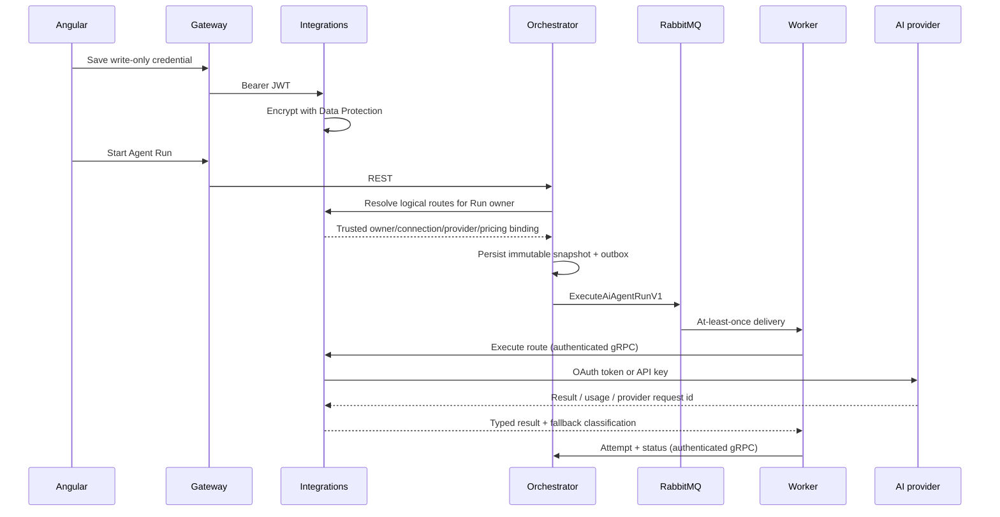

# AI-провайдери, маршрути моделей і безпечне виконання

## Межі відповідальності

- **Integrations** зберігає user-scoped `ProviderConnection`, шифрує credentials через ASP.NET Core Data Protection, отримує dynamic model catalog і виконує provider request.
- **ControlPlane** зберігає декларативну AI-конфігурацію `AgentDefinition`: system prompt, ordered `ModelRoutes`, allowlisted tools і per-run budgets.
- **Orchestrator** перед створенням Run резолвить логічні routes через Integrations для власника Run, зберігає trusted immutable binding, `AiProviderAttempt` і versioned checkpoint.
- **Worker** читає snapshot з versioned RabbitMQ command, послідовно виконує routes через authenticated gRPC і звітує прогрес назад в Orchestrator. Внутрішній Integrations gRPC endpoint явно обходить JWT fallback policy, але сам fail-closed перевіряє окремий `x-worker-api-key` constant-time порівнянням; публічний REST і надалі вимагає Bearer JWT.



## Credentials та user isolation

OpenAI/xAI keys, GitHub OAuth tokens і резервні GitHub fine-grained PAT є write-only. REST DTO показує лише короткий SHA-256 fingerprint. Значення зберігається як Data Protection ciphertext в окремій `integrations` schema; key ring лежить у persistent volume з окремим application name. Purpose chain credential містить schema/version, provider, owner, connection і credential version; OAuth PKCE verifier має окремий purpose із provider, owner та flow ID. Ciphertext не можна переставити між providers, users, connections або типами даних. Кожен repository lookup містить `owner_user_id`, тому один користувач не може використати connection іншого.

GitHub Copilot використовує офіційний `GitHub.Copilot.SDK` 1.0.26. Основним способом підключення є OAuth; резервним — персональний fine-grained PAT із permission `Copilot Requests`. Classic PAT `ghp_` відхиляється. SDK отримує explicit token конкретного користувача і запускається з `UseLoggedInUser=false`, отже локальна GitHub CLI/Copilot сесія та environment tokens не є fallback. OAuth flow використовує PKCE, криптографічний state, 10-хвилинний TTL і single-use consumption.

PAT endpoint спочатку перевіряє префікс `github_pat_`, GitHub identity, введений
користувачем очікуваний login, незмінність numeric account ID для наявного
connection, Copilot bearer exchange і непорожній каталог моделей. Лише після
успіху PAT шифрується та створює або атомарно замінює owner-scoped GitHub
connection. Validation failure не записує PAT і повертає typed safe error.
Generic create/credential-rotation endpoints не приймають GitHub credentials,
тому `ghp_` або інший token не може обійти OAuth/PAT validation flow.

Fine-grained PAT обробляється як opaque secret: frontend і backend прибирають
лише зовнішній whitespace, перевіряють тип за префіксом `github_pat_`, наявність
opaque payload та розумну верхню межу довжини. Вони не залежать від фіксованої
довжини або regex внутрішнього формату GitHub. Whitespace усередині credential
відхиляється як malformed input, а справжність token підтверджується лише через
GitHub identity, Copilot bearer exchange та model catalog. Repository permissions
не є локальною передумовою: для цього flow потрібен account permission
`Copilot Requests`.

Bundled Copilot runtime є glibc executable, тому production image `integrations-api`
базується на стандартному Debian ASP.NET runtime, а не Alpine/musl, і містить
native GSSAPI runtime (`libgssapi-krb5-2`), потрібний Copilot CLI. Перевірка
підключення складається з незалежних кроків: GitHub `GET /user` підтверджує OAuth
identity та зберігає numeric account ID/login; Copilot SDK `models.list`
підтверджує доступність каталогу; `account.getQuota` лише додає provider-reported
quota metadata. Недоступна або змінена quota schema не робить connection
невалідним, якщо identity і models успішні. SDK отримує ту саму розшифровану
credential version, що належить owner connection, через `GitHubToken`, а
`UseLoggedInUser=false` забороняє fallback на CLI/environment identity.

`401` від GitHub identity означає `RequiresReconnect`; `429`, timeout/network,
`403` класифікується за безпечним machine-readable upstream response як
`PolicyBlocked`, `OAuthAppUnsupported`, `NotEntitled` або `InsufficientPermissions`;
ці постійні відмови не маскуються як тимчасовий `Degraded`. Лише `5xx`, timeout і
транспортна недоступність дають `Degraded` без видалення credential. `NotEntitled`
та `QuotaExhausted` встановлюються лише для явних
allowlisted upstream code, а не за назвою plan, quota key, usage, balance,
наявністю premium-моделі чи порожнім каталогом. Успішний model catalog зберігає
`LastSyncedAt`; кожна перевірка зберігає `LastValidatedAt`. Structured logs
містять лише operation, correlation ID, exception type, безпечний provider code
та status; token і raw provider response не записуються. Callback request logging
містить method, path, status і duration, але навмисно не записує query string із
`code` та `state`.

### Локальна конфігурація GitHub OAuth

OAuth App створюється користувачем у [GitHub Developer settings](https://github.com/settings/developers).
Для стандартного локального Docker Compose stack потрібно вказати:

- Homepage URL: `http://localhost:8080/`;
- Authorization callback URL: `http://localhost:8080/api/integrations/v1/provider-connections/github/oauth/callback`.

У локальному ignored `.env` задаються `GITHUB_COPILOT_OAUTH_ENABLED=true`,
`GITHUB_COPILOT_CLIENT_ID`, `GITHUB_COPILOT_CLIENT_SECRET` і
`GITHUB_COPILOT_CALLBACK_URL`. Callback є серверною allowlisted конфігурацією:
frontend не визначає його і не може підмінити `redirect_uri` або `returnUrl`.
Compose передає їх у `integrations-api` як `Providers:GitHub:Enabled`,
`Providers:GitHub:ClientId`, `Providers:GitHub:ClientSecret` і
`Providers:GitHub:CallbackUrl` відповідно.
Після зміни параметрів достатньо перебудувати за потреби та recreate лише
`integrations-api`; значення Client Secret ніколи не повертається через REST.

Коли OAuth вимкнений server-side capability, UI не показує кнопку, а прямий
виклик endpoint повертає typed `409 GitHubCopilotOAuthDisabled`. Якщо OAuth явно ввімкнений без Client ID, Client Secret або
коректного callback, `integrations-api` зупиняється на startup validation.

Callback дозволений лише на точному loopback path для локальної розробки або на HTTPS origin із allowlist. Start/callback/credential endpoints мають owner/IP rate limit. Access/refresh token зберігаються в одному encrypted envelope; refresh rotation замінює credential, збільшує version та інвалідує model snapshot.

### GitHub custom OAuth verification gap

Локальний live POC 27 жовтня 2026 року підтвердив: official Copilot CLI device
flow для того самого персонального Copilot Student account виконує контрольний
запит, але token конкретного custom OAuth App доходить до
`api.github.com/copilot_internal/v2/token` і отримує `403`. Підписка та account
policy справні; відмова обмежена custom OAuth credential/client. Це зовнішній
verification gap GitHub, а не `NotEntitled`. OAuth flow збережений як основний,
але до підтвердження GitHub для development можна використати write-only
fine-grained PAT із `Copilot Requests`. Token Copilot CLI не копіюється в
AiControlCenter, `.env` або базу.

### Development-only Local Copilot CLI

Для особистого local E2E доступний окремий provider kind
`GitHubCopilotLocalCli`. Це не fallback OAuth/PAT і не production credential
mode. Він вимкнений за замовчуванням, дозволений лише в `Development` і
server-side прив'язаний до одного `Identity` user ID. Інший користувач не бачить
кнопку підключення та не може резолвити connection власника.

Офіційний Copilot CLI 1.0.103 запускається окремим Compose sidecar у профілі
`local-copilot`. Bundled executable має SHA-256
`f19b3554a6b62605db3a26d5255ebe2a3ee39fcd6a357edb18301ea5037f6f0d`.
Архів завантажується з GitHub Release та перевіряється за офіційним
`SHA256SUMS.txt`. Sidecar не публікує порт на host, працює без Linux
capabilities, із `no-new-privileges`, read-only root filesystem та окремим
`local_copilot_home` volume. `Integrations` підключається лише до allowlisted
`local-copilot-cli:4321` через `RuntimeConnection.ForUri` і shared
`COPILOT_CONNECTION_TOKEN` з ignored `.env`. Довільний endpoint, loopback,
metadata IP або `host.docker.internal` startup validation не приймає.

Runtime-сесія використовує `CopilotClientMode.Empty`, вимкнений session store і
лише точні canonical wire names custom tools, які передані AiControlCenter.
Built-in shell, filesystem, MCP і edit tools не allowlisted. Copilot login
зберігається тільки у sidecar `COPILOT_HOME`; token не копіюється в БД,
Data Protection, frontend або `.env`. Usage/credits залишаються `Unavailable`,
якщо runtime не повертає точних даних. Недоступний sidecar дає typed temporary
provider failure без прихованого переходу на платний route.

Локальне ввімкнення в ignored `.env`:

```dotenv
LOCAL_COPILOT_CLI_ENABLED=true
LOCAL_COPILOT_CLI_CONNECTION_TOKEN=<48-byte Base64URL secret>
LOCAL_COPILOT_CLI_OWNER_USER_ID=<Identity user UUID>
LOCAL_COPILOT_CLI_REQUEST_TIMEOUT_SECONDS=120
```

Device authorization запускається окремо й не виводить credential у
AiControlCenter:

```powershell
docker compose --profile local-copilot up --detach --build local-copilot-cli integrations-api
```

Після запуску device flow відкривається лише з owner-scoped сторінки
`/providers`; окремий interactive login container більше не потрібний.

Звичайна дія «Перевірити підключення» ніколи не виконує logout або новий device
flow за наявності credential: sidecar bounded-перезапускає runtime та перевіряє
збережену сесію. За відсутнього credential та сама керована operation запускає
підтриманий `copilot login --device-code` у тому самому sidecar, `HOME` і
`COPILOT_HOME`. Після підтвердження GitHub sidecar переходить через
`PersistingCredential`, bounded-перезапускає runtime і лише тоді починає validation.
Credential-файли вручну не видаляються, а `local_copilot_home` volume зберігається.
Внутрішній management endpoint
`http://local-copilot-cli:4322` доступний лише через token-protected container DNS;
порт не публікується на host. Frontend отримує лише operation ID, GitHub verification
URL, одноразовий user code, expiry та безпечний стан. CLI token, config path, stdout і
headers не повертаються. Після `GitHubAuthorized` старий headless child bounded-зупиняється,
новий child запускається з тим самим `COPILOT_HOME`, очікується readiness порту `4321`,
після чого Integrations окремо виконує validation та synchronization models. Лише
після всіх цих кроків стан стає `Authorized`. Device authorization lifecycle проходить
`StartingLogin` → `WaitingForUser` → `GitHubAuthorized` → `PersistingCredential` →
`RestartingRuntime` → `Validating` → `SynchronizingModels` → `Authorized`; помилки
розділено на `LoginFailed`, `RuntimeRestartFailed`, `ValidationFailed` і
`ModelSyncFailed`. Owner-scoped current-operation endpoint відновлює активний modal
після browser reload, не створюючи другу operation. Polling endpoint-и виключені з
mutation rate limit; transient `429/5xx` повторюється до expiry тієї самої operation.
Кожна operation має correlation ID, нормалізований error code і, за наявності,
безпечний process exit code без raw stdout/stderr.
Terminal success не може бути переписаний пізнім exit старого child process.
Одночасно активною може бути лише одна validation/device-authorization operation;
повторний click отримує поточну operation замість другого login.

Зафіксована версія 1.0.103 не має direct `auth` subcommand, `copilot logout` або
force-login option. Interactive `/logout` не використовується без доведеного
machine-readable transport contract. Тому server-side capabilities для примусової
повторної авторизації та logout дорівнюють `false`: UI приховує ці дії, а прямі
owner-scoped endpoint-и fail-closed повертають typed `409`. Це verification gap
bundled CLI, а не причина видаляти credential-файли чи `local_copilot_home` volume.

У container немає системного keychain. Лише для цього owner-scoped Development
sidecar дозволене підтвердження точного CLI prompt про plaintext storage. Менеджер
розпізнає тільки allowlisted prompt, не логуючи raw output; credential залишається
тільки у dedicated `local_copilot_home` volume. Ця модель заборонена для shared,
Staging і Production deployment.
Revoke видаляє тільки connection у БД і не видаляє volume та не виконує CLI logout.

У `Production` або `Staging` явне ввімкнення завершує startup validation
fail-closed.

## Routing, fallback і бюджети

AgentDefinition зберігає логічний provider requirement. Для звичайних provider routes може використовуватися display name connection; для Development-only `LocalCopilotCli` зберігається explicit connection ID, бо цей provider прив'язаний до єдиної owner-scoped sidecar session. Цей ID не є trusted identity або credential: під час create/update ControlPlane передає owner із перевіреного JWT до Integrations через authenticated gRPC, а Integrations повторно перевіряє owner, active status, persisted provider kind, server capability і model catalog. Foreign, inactive або forged ID дає typed field validation і Agent не зберігається. При старті Run та сама server-side resolution виконується знову лише серед active connections власника Run. Trusted snapshot містить owner, connection ID, persisted provider, paid/free classification та pricing-known flag. Integrations повторно звіряє owner і expected provider до розшифрування credential або outbound call; mismatch завершується fail-closed.

Frontend читає owner-scoped capabilities, connection list і Local CLI runtime status. Preset `Local Copilot CLI` доступний лише коли server feature увімкнений, поточний user є configured owner, sidecar `Ready`, authentication `Active`, каталог синхронізований і існує active Local connection. Він створює рівно один route: `LocalCopilotCli`, priority 1, explicit connection, `Auto`, max attempts 1, timeout 60 секунд, без paid execution, paid fallback і fallback routes. Інші presets не створюють часткової конфігурації, якщо хоча б один required connection недоступний.

Provider DTO повертає лише display metadata: GitHub login, connection name/status, last validation, last successful validation, last model sync та credential status source. `credentialExpiresAt` показується лише коли його реально повідомив provider/runtime; інакше UI прямо пояснює, що точний строк невідомий, без вигаданого countdown. Provider-reported дата в межах семи днів позначається `Expiring soon`.

Routes мають унікальний позитивний `priority` і виконуються по порядку. Unknown JSON fields і numeric/unknown provider values відхиляються. Fallback дозволений лише для quota, rate limit, temporary/model unavailability та insufficient funds. Authentication, validation, safety, cancellation, tool/configuration errors і ambiguous timeout завершують Run без переходу до іншого провайдера.

Ліміти input/output tokens, estimated USD cost і максимальна кількість attempts належать Run snapshot. Для paid route обов'язкові окремі `paidExecutionAllowed`, `paidFallbackAllowed`, positive per-route safety cap та daily/monthly/request caps. Одиницею request accounting є фактичний outbound provider request, а не один logical execution receipt: catalog GET, початковий generation POST і кожний наступний model turn резервують окремий request slot. Перед кожним таким викликом Integrations у `SERIALIZABLE` PostgreSQL transaction бере owner/connection advisory lock; concurrent executions не можуть перевищити денний або місячний cap. Pending/ambiguous receipt займає `reserved_request_count`, а reconciliation замінює його на server-side `actual_request_count`; значення від frontend або Worker не використовується. Cost reservation і надалі консервативно враховує максимально можливі tool turns, route/run caps та completed/pending/ambiguous usage. Unknown-priced paid model блокується.

Catalog GET failure є безпечною transient-відмовою. Кожний Local Copilot SDK execution проходить типізовані межі `RuntimeStart`, `Authentication`, `ModelCatalog`, `ModelResolution`, `SessionCreate`, `GenerationDispatch` і `GenerationResponse`. Для кожної межі зберігаються лише безпечні start/completion markers, duration, normalized result code, allowlisted exception type та provider request fingerprint, якщо SDK його надав. Prompt, raw SDK output і credential у diagnostics не потрапляють. Після початку `SendAndWait` transport failure, timeout, broken connection або cancellation без підтвердженої відповіді класифікуються як `AmbiguousTimeout`: `generationDispatched` має значення `true` або `unknown`, request correlation зберігається, receipt залишається `Ambiguous`, а blind retry, fallback і Resume заборонені до окремої reconciliation/manual resolution. Generic exception без відомої stage також fail-closed вважається ambiguous, а не retryable. Для історичних Local CLI receipts із `local_copilot_cli_unavailable`, створених до появи stage markers, Integrations виконує owner-scoped safety inspection. Відсутність доказу `generationDispatched=false` повертає `LegacyAmbiguousOutcome`: Orchestrator блокує Resume typed `409` до provider preflight, а UI рекомендує створити окремий новий Run. Історичний `Completed` receipt та attempt при цьому не переписуються й не копіюються до нового Run.

Це не внутрішній гаманець: поповнення й фактичний billing залишаються у провайдера. Якщо всі допустимі routes доведено тимчасово недоступні до generation dispatch, Run переходить у `PausedProviderUnavailable`; для billing — у `PausedInsufficientFunds`. Ambiguous outcome завершує Run помилкою та не надає Resume. Для дозволеного Resume frontend генерує стабільний operation ID на одну user action; Orchestrator використовує його як transport message ID під row lock, тому подвійний click або повтор того самого HTTP request не створює другу команду. Resume не скидає загальний attempt budget.

Перед зовнішнім викликом Integrations повторно читає live model catalog. Безпосередньо перед Local CLI generation adapter додатково перевіряє runtime authentication, щоб закрити race між catalog read і execution. Якщо catalog має одну конкретну модель, `Auto` server-side резолвиться в цей ID до session creation. Якщо catalog повертає офіційний sentinel `auto`, SDK отримує підтримуваний `Model = "auto"` і runtime сам обирає модель. У такому разі `ActualModel` заповнюється лише з `GetCurrent`/provider response; sentinel `auto` ніколи не видається за фактичну модель. Unknown explicit model блокується на `ModelResolution` до session creation. Catalog snapshot зберігається лише як bounded user-scoped metadata для last sync; execution не довіряє застарілому snapshot. Disconnect/credential replacement видаляє його. Втрата authentication переводить connection у `RequiresReconnect`; Worker зберігає checkpoint і ставить Run у `PausedProviderUnavailable` без paid fallback. Після контрольованого відновлення користувач може Resume з останнього checkpoint.

## Tools

Worker не виконує shell-команди й не приймає довільні URLs або paths. Поточний server allowlist: `system.utc-time` та `text.length`. Unknown tool повертає typed `tool_not_allowed`; tool failure не дозволяє provider fallback.

Provider adapters передають transport-neutral definitions і повертають typed calls, але не запускають server tool самі. Integrations allowlisted executor перевіряє name/schema/arguments, timeout, cancellation і size limits; shell, довільні URL/path та arbitrary code відсутні. Provider-controlled identifiers канонізуються на boundary до tool decision, receipt, transport і checkpoint: request ID — до 256 UTF-8 bytes, actual model — до 128, provider — до 32, failure/checkpoint status — до 64; persistence status, finish/metric sources, correlation та idempotency identifiers мають відповідні спільні contract limits. Надмірний або структурно небезпечний request/model identifier замінюється ASCII-safe representation із SHA-256 fingerprint, тому raw значення не потрапляє у receipt, response, checkpoint чи log, а різні значення не зливаються через просте обрізання.

Worker перед кожною provider attempt тим самим canonical JSON serializer будує повний статичний checkpoint envelope: route snapshot, усі вже збережені attempt references, один максимальний reference поточного attempt (рівно один може бути доданий до наступного checkpoint), schema/version/cursor/timestamp та майбутній SHA-256 hash. Budget дорівнює точному залишку від спільної межі 65,536 UTF-8 bytes — фіксованого metadata reserve немає. Через authenticated internal gRPC Integrations отримує тільки цей server-generated залишок; перед tool execution воно серіалізує baseline і candidate з arguments, existing results, worst-case bounded result, partial output та JSON overhead і порівнює точну UTF-8 delta з budget. Відсутній, некоректний або недостатній budget закривається fail-closed: executor не викликається, повертається typed `tool_audit_budget_exceeded`. Worker незалежно перевіряє повний фінальний checkpoint перед `ReportAttempt`. Result повертається провайдеру наступним bounded model turn. OpenAI/xAI використовують Responses function-call items; Copilot SDK реєструє лише allowlisted callback declarations, що фіксують deferred typed call; deterministic adapter відтворює той самий контракт.

Provider execution receipt/reservation створюється до generation/tool cycle. Повтор completed idempotency key повертає збережений result, а pending/ambiguous receipt не запускає tool/provider повторно. Tool call ID та idempotency key унеможливлюють повтор уже підтвердженого tool. Typed tool audit проходить Integrations → Worker → Orchestrator і входить у persisted checkpoint.

## Checkpoint і Resume

Orchestrator зберігає JSON checkpoint розміром не більше 65,536 UTF-8 bytes із schema/checkpoint version, logical step, confirmed context, явно незавершеним partial output, завершеними tool calls/results, provider attempt references, resume cursor, last-safe timestamp, SHA-256 hash і immutable route snapshot. Worker вимірює фактичний serialized payload до `ReportAttempt`; oversized checkpoint не передається, а Run контрольовано завершується помилкою замість нескінченного `Running`/transport retry. Worker передає безпечний checkpoint через versioned RabbitMQ command, відновлює prior tool results і не виконує той самий call ID повторно. Orchestrator незалежно повторює UTF-8 bound, перевіряє hash, монотонну version, cursor і точний збіг route snapshot. PostgreSQL row lock та run status не дозволяють двом паралельним Resume створити два виконання.

## Pricing metadata

Dynamic provider catalog є джерелом доступності моделей. Оцінка вартості виконується лише для відомих model IDs; для невідомої моделі повертається `null`, а не вигадана ціна. Вбудовані ставки звірено 2026-10-06 з офіційними [OpenAI API pricing](https://developers.openai.com/api/docs/pricing) та [xAI pricing](https://docs.x.ai/developers/pricing). Фактичний рахунок і balance UI провайдера залишаються authoritative.

## Тестування без витрат

`DeterministicTestProvider` покриває success, validation failure, rate limit, quota, temporary unavailable, ambiguous timeout і allowlisted tool scenario. Окремий сценарій `quota-once` детерміновано ставить перший attempt на pause та дозволяє перевірити успішний Resume наступним attempt. Провайдер не виконує мережевих або paid requests і повертає детерміновані usage/cost values.

Controlled HTTP handlers перевіряють OpenAI/xAI mapping, cached-token parsing, max output limit, ambiguous generation transport, oversized provider metadata і tool turns, а injectable Copilot runtime — офіційний adapter boundary без user credentials. Focused Copilot tests окремо перевіряють identity, models, schema-tolerant quota та typed failure classification. REST production-composition test проходить JWT endpoint → PostgreSQL entity → Data Protection decrypt актуальної credential version → production GitHub adapter → persisted identity/catalog/status, замінюючи лише зовнішню мережу контрольованими doubles. PostgreSQL/Testcontainers перевіряє atomic per-request reservation, reconciliation, concurrent cap і migration lifecycle; Worker tests перевіряють exact worst-case checkpoint budget, terminal handling oversized checkpoint та відсутність fallback після ambiguous paid attempt. Окремий production-composition test проходить generated gRPC client → protobuf serialization → реальний Kestrel HTTP/2 → `AiProviderExecutionGrpcService`: ненульове budget-поле доходить без змін, а відсутнє/default `0` блокує tool до executor без retry storm. Live Copilot smoke не виконується автоматично й залишається окремою user-authorized перевіркою. Live OpenAI/xAI billing не виконується; provider-reported balance не заявляється, коли API його не надає.

Поточний end-to-end transport є unary/bounded. Хоча зовнішні API можуть підтримувати streaming, adapters не оголошують цю capability, доки checkpointed streaming, partial delivery та reconnect не реалізовані й не перевірені. Partial-output поле зберігається для типізованих provider failures; безшовного перенесення активного stream між провайдерами немає.

[ADR 0008](adr/0008-ai-provider-boundaries.md) фіксує provider abstraction, secret ownership, fallback та ambiguous-timeout рішення.
