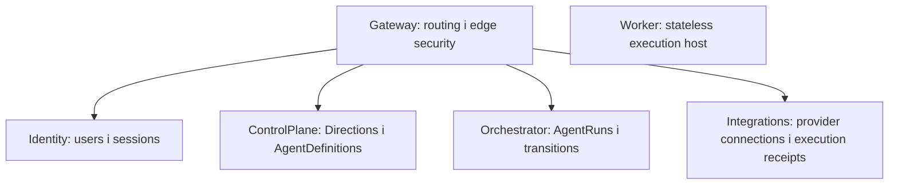

# Межі сервісів

## Gateway

Публічна точка входу для REST і технічного SignalR Hub. Не володіє business-даними, не посилається на service layers, перевіряє Identity-issued JWT і застосовує YARP policies. Read-only Operations Center BFF агрегує bounded health/queue/status snapshots, але не зберігає їх і не повертає secrets.

## Identity

Володіє users, fixed system roles, password hashes, стабільними `RefreshSession`, історією rotating refresh tokens та схемою `identity`. Це єдиний сервіс із private signing key. Public registration відсутня; users створює Admin.

## ControlPlane

Володіє схемою `control_plane`, aggregates `Direction` і `AgentDefinition`, REST-каталогом та versioned gRPC snapshot. AI-конфігурація агента (prompt, ordered routes, tools і safety limits) є декларативною; credentials тут не зберігаються. REST і gRPC захищені delegated user authentication; інші сервіси не читають цю схему напряму.

## Orchestrator

Володіє схемою `orchestrator`, `AgentRun`/`RunStep`, immutable trusted AI snapshot, `AiProviderAttempt`, versioned/hash-verified checkpoint, pause/resume transitions і transactional outbox. Отримує декларативний Agent snapshot через ControlPlane gRPC, резолвить логічні provider routes через Integrations для власника Run, публікує versioned commands/status events і приймає Worker progress через окремо authenticated gRPC.

## Worker

Stateless host з MassTransit consumers для bounded Test та AI workflow. Він координує trusted ordered routes, fallback, attempt cursor і checkpoint transport, але не читає PostgreSQL, credentials або private signing key. Provider adapters лише декодують typed tool calls; allowlisted tool executor знаходиться в Integrations Application boundary. Shell, довільні URLs/paths і довільне виконання відсутні.

## Integrations

Володіє схемою `integrations`, user-scoped `ProviderConnection`, OAuth state, atomic budget reservations і durable execution receipts. Лише цей сервіс розшифровує provider credential, резолвить route до connection власника Run, перевіряє dynamic model catalog, виконує allowlisted tools і викликає GitHub Copilot/OpenAI/xAI adapters. Public REST приймає delegated JWT; Orchestrator і Worker використовують окремий authenticated gRPC boundary. Raw credentials ніколи не виходять із сервісу.

## Власність даних

Development використовує один PostgreSQL server, але кожен data owner має окрему schema, login role і connection string. Role не отримує privileges на чужу schema. Cross-service reads можливі лише через versioned REST, gRPC або message contracts.

[Сервіси](../../src/Services/README.md) · [Правила залежностей](dependency-rules.md) · [Комунікація](communication.md)
