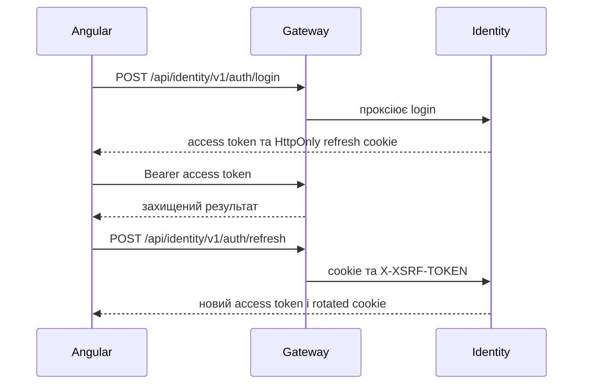

# AiControlCenter Angular

Односторінковий Angular-клієнт працює за тим самим origin, що й Nginx/Gateway. Він реалізує вхід, відновлення сесії, зміну тимчасового пароля, захист маршрутів, панелі напрямків і тестових агентів, запуск виконання та live-перегляд статусу через SignalR.

## Потік сесії



## Основні компоненти

- `AuthStore` ініціалізує CSRF cookie, пробує refresh під час старту, зберігає користувача та координує паралельні refresh-запити. Невдалий runtime refresh очищає session і переводить на login один раз.
- `AccessTokenStore` тримає access token лише в оперативній пам’яті; `localStorage` і `sessionStorage` не використовуються.
- `authInterceptor` додає Bearer token лише до захищених same-origin API. Він координує один refresh, а staggered `401` для старого token повторює з уже актуальним token без другого refresh; `403` та auth endpoints refresh не запускають.
- `authGuard`, `passwordChangedGuard` і `roleGuard` контролюють маршрути клієнта; серверні policies залишаються остаточним захистом.
- `RealtimeService` підключається до `/hubs/system`, передає актуальний access token, викликає технічний `Ping` і приймає обмежені `RunStatusChanged` events. Після reconnect сторінка Run перечитує REST-джерело істини.
- `LoginComponent`, `ChangePasswordComponent`, `ShellComponent` та `ForbiddenComponent` формують наявний UI.
- `DirectionListComponent` показує loading/empty/error states, pagination, фільтри та дозволені дії; `DirectionFormComponent` надає reactive create/edit form з одним atomic update request. `DirectionApiService` звертається лише до same-origin Gateway route.
- `AgentListComponent` і `AgentFormComponent` підтримують пошук, фільтри, pagination, керування визначеннями та запуск активного Test agent відповідно до ролі.
- `RunListComponent` читає список через REST. `RunDetailComponent` виконує SignalR-triggered REST reconciliation, застосовує лише новіші revisions і відновлює кроки та журнал після reload/reconnect.
- `ProviderConnectionsComponent` керує owner-scoped GitHub/OpenAI/xAI/Deterministic connections. API keys і резервний GitHub fine-grained PAT є write-only: після create/replace поле очищається, а UI отримує лише fingerprint і safe metadata.
- GitHub OAuth status отримується з Integrations API. Для `NotConfigured` UI показує пояснення, блокує кнопку та не виконує browser navigation; callback URL визначає лише backend.
- GitHub OAuth залишається основним способом. Кнопка «Резервний fine-grained PAT» відкриває окрему password-форму з очікуваним GitHub login; приймається лише `github_pat_` із permission `Copilot Requests`, classic `ghp_` відхиляється. Secret очищається після submit і ніколи не рендериться назад.
- PAT і login нормалізують зовнішній whitespace перед submit; login із дефісом підтримується. PAT обробляється як opaque secret із prefix/bounds validation, без fixed-length regex. Локальні та backend typed errors показуються окремо, не розкриваючи credential.
- `/providers` читає server-side capabilities: вимкнені OAuth/PAT actions приховані й не визначаються frontend-конфігурацією. Якщо backend явно ввімкнув owner-scoped Development mode, сторінка показує картку «Local Copilot CLI — лише для локальної розробки» зі станом runtime.
- За чинного Local CLI credential основна дія «Перевірити підключення» використовує fast path без logout/device flow. За відсутнього credential дія «Підключити Local Copilot CLI» запускає керований `copilot login --device-code`. Device-flow modal відображає лише офіційний GitHub URL, одноразовий code, expiry і safe stage: `StartingLogin`, `WaitingForUser`, `GitHubAuthorized`, `PersistingCredential`, `RestartingRuntime`, `Validating`, `SynchronizingModels`, `Authorized` або окремий terminal failure. Активна operation відновлюється після reload без запуску другого login; polling переживає тимчасові `429/5xx`, а після terminal state кнопка «Скасувати» змінюється на «Закрити». Bundled Copilot CLI 1.0.103 не має підтверджених команд logout або примусового login, тому server-side capabilities приховують «Увійти заново / змінити акаунт» і «Завершити локальну сесію», а прямі виклики цих endpoint-ів завершуються typed `409`. CLI credential, endpoint token, config path і raw output у browser не передаються.
- Validate показує підтверджений GitHub login, час останньої перевірки/синхронізації та безпечну типізовану причину: `RequiresReconnect`, `NotEntitled`, `PolicyBlocked`, `OAuthAppUnsupported`, `InsufficientPermissions`, `QuotaExhausted`, rate limit або справді тимчасову деградацію. Поле «Версія credential» змінюється лише після фактичної заміни/refresh OAuth credential, а звичайна validation не створює нової версії. Raw provider response і credentials у UI не передаються.
- AI-форма агента будує ordered логічний `ModelRoute` з реальних owner-scoped connections. Окремий preset `Local Copilot CLI` доступний лише за server capability, `Ready` sidecar, active authentication, synchronized model catalog та active Local connection; він автоматично вибирає єдиний connection, `Auto`, priority 1, max attempts 1, timeout 60 секунд і завжди вимикає paid execution/fallback. Explicit Local connection ID є лише untrusted binding hint: ControlPlane перевіряє його через Integrations під час create/update, а backend повторно резолвить owner/provider/status/model перед Run. Недоступні presets disabled і показують причину, не створюючи частковий route. Advanced JSON залишено для діагностики, але він не є єдиним способом конфігурації.
- Local CLI картка й ModelRoute показують тільки безпечні account metadata: GitHub login, display name, provider/status, last successful validation, last model sync і credential status source. Точна expiry date відображається лише коли її повідомив runtime; інакше немає вигаданого countdown. Typed route ProblemDetails показується біля ModelRoute разом із safe correlation ID. Втрата authentication не запускає paid fallback: connection переходить у recovery state, Run — у `PausedProviderUnavailable` зі збереженим checkpoint.
- Run details показує persisted attempts/checkpoint metadata та відрізняє provider-reported cached tokens від недоступного значення; відсутнє поле не перетворюється на вигаданий `0`.

## Маршрути

| URL                    | Компонент і захист                                     |
| ---------------------- | ------------------------------------------------------ |
| `/login`               | `LoginComponent`, публічний                            |
| `/change-password`     | `ChangePasswordComponent`, `authGuard`                 |
| `/forbidden`           | `ForbiddenComponent`, `authGuard`                      |
| `/`                    | `ShellComponent`, `authGuard` + `passwordChangedGuard` |
| `/directions`          | список, усі platform roles після зміни пароля          |
| `/directions/new`      | створення, додатково `roleGuard(Admin)`                |
| `/directions/:id/edit` | редагування, додатково `roleGuard(Admin)`              |
| `/agents`              | список і запуск Test agent, усі platform roles         |
| `/agents/new`          | створення, `roleGuard(Admin, Developer)`               |
| `/agents/:id/edit`     | редагування, `roleGuard(Admin, Developer)`             |
| `/home`                | Operations Center: topology, health, queues і Runs     |
| `/runs`                | власні Runs; Admin бачить усі                          |
| `/runs/:id`            | деталі, кроки, журнал і live status                    |
| `/providers`           | власні AI provider connections, models, usage і sync   |

## Запуск і перевірка

Із кореня репозиторію:

```powershell
npm.cmd ci --prefix .\frontend\ai-control-center-angular
npm.cmd start --prefix .\frontend\ai-control-center-angular
npm.cmd test --prefix .\frontend\ai-control-center-angular -- --watch=false
npm.cmd run build --prefix .\frontend\ai-control-center-angular -- --configuration production
```

Тести перевіряють ініціалізацію/refresh сесії, memory-only token, збереження активної сесії під час transient outage, захисні guards, production `RealtimeService` через injectable SignalR factory, bounded reconnect/polling, single event subscription, API mapping Directions/Agents/Runs/Operations і REST reconciliation після SignalR event або reconnect. Stage 5 regression-тести додатково перевіряють write-only credentials, очищення secret fields, safe HTTP errors, model catalog request, ordered routes, paid caps та presets. Окремий Kestrel integration test зупиняє та відновлює Gateway на тому самому endpoint і підтверджує automatic reconnect того самого SignalR client без ручного створення нового connection.

## Пов’язана документація

- [Головний README](../../README.md)
- [Повний authentication flow](../../docs/identity/authentication-flow.md)
- [Спільна JWT-безпека](../../docs/security/security-overview.md)
- [Gateway](../../src/Gateway/AiControlCenter.Gateway/README.md)
- [Directions](../../docs/architecture/directions.md)
- [Agents, Runs і Worker](../../docs/architecture/agents-runs-worker.md)
- [Operations Center і live observability](../../docs/architecture/operations-center.md)
- [AI-провайдери, routing, budgets і tools](../../docs/architecture/ai-providers.md)
