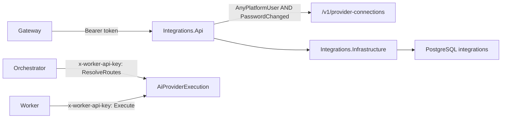

# AiControlCenter.Integrations.Api

ASP.NET Core host надає provider connection API, GitHub OAuth callback, internal provider-execution/resolution gRPC, `/service-info` і health endpoints.

API повторно перевіряє JWT після Gateway. Internal gRPC резолвить логічні routes лише до connections власника Run, повторно перевіряє owner/provider і переносить typed tool definitions/results без credentials. GitHub callback анонімний лише на transport-рівні та захищений 256-bit state, PKCE, строком дії й single-use записом. Readiness використовує `IntegrationsDbContext`; liveness залишається анонімним. `InternalGrpc:ApiKey` обов'язковий і не має tracked default.

GitHub OAuth є основним opt-in способом (`Providers:GitHub:Enabled=false` за замовчуванням).
Client ID, Client Secret і повний Callback URL читаються лише з конфігурації
Integrations API. Disabled-конфігурація повертає typed `NotConfigured`; enabled
конфігурація без обов'язкових значень не проходить startup validation.
Copilot SDK запускається в glibc-сумісному Debian runtime image. Validate
використовує OAuth token власника connection і реальний model catalog; transient
provider failures не перетворюють credential на `Invalid`. Request logging
ніколи не включає query string OAuth callback, тому `code` і `state` не
потрапляють у structured logs.

`PUT /v1/provider-connections/github/pat` надає резервне owner-scoped
підключення через персональний fine-grained PAT. Request містить write-only
`personalAccessToken` та `expectedGitHubLogin`; відповідь ніколи не містить
token. Endpoint приймає лише `github_pat_`, відхиляє classic `ghp_`, до запису
перевіряє GitHub identity, existing numeric account binding, Copilot bearer
exchange і каталог моделей. Успішний PAT захищається тим самим Data Protection
purpose chain, а UI отримує лише fingerprint і safe metadata.
Generic create та credential replacement endpoints відхиляють GitHub provider:
GitHub credential можна змінити лише через OAuth або validated fine-grained PAT flow.
Зовнішній whitespace нормалізується; token розглядається як opaque value без
fixed-length regex. Repository permissions не вимагаються локально, а provider
validation підтверджує account permission `Copilot Requests`.

`GET /v1/provider-connections/capabilities` є єдиним джерелом UI feature flags для
GitHub OAuth, PAT і Local CLI. Disabled OAuth/PAT endpoints повертають typed `409`;
реалізації, контракти й міграції не видаляються.

Development-only endpoint `/v1/provider-connections/local-copilot/status`
показує лише `Disabled`, `Unavailable`, `AuthorizationRequired` або `Ready` і не
повертає endpoint чи connection token. `PUT /local-copilot` створює окремий
owner-scoped `GitHubCopilotLocalCli` connection без credential у БД. Режим
вмикається тільки через `Providers:LocalCopilotCli`, прив'язується до одного
`OwnerUserId`, приймає лише internal endpoint `local-copilot-cli:4321` та не
проходить startup validation поза `Development`. `POST /local-copilot/reconnect`
перевіряє наявну сесію без logout і нового login; за відсутнього credential він
запускає керований `copilot login --device-code`. Після `GitHubAuthorized` sidecar
фіксує `PersistingCredential`, bounded-перезапускає runtime, перевіряє його readiness,
а Integrations виконує validation і model synchronization. Активну operation можна
відновити після reload через owner-scoped `GET /local-copilot/reconnect/current`;
повторний click повертає ту саму operation. Polling endpoint-и не ділять mutation
rate limit, а transient `429/5xx` не втрачає operation.

Зафіксований Copilot CLI 1.0.103 підтримує `copilot login --device-code`, але не має
підтверджених `copilot auth logout`, `copilot logout` або force-login option.
Тому capabilities `LocalCopilotCliReauthenticationEnabled` і
`LocalCopilotCliLogoutEnabled` залишаються `false`, UI не показує небезпечні дії, а
`POST /local-copilot/reauthenticate` і `POST /local-copilot/logout` fail-closed
повертають typed `409`. Credential-файли вручну не видаляються; endpoint-и не читають
і не повертають CLI credential, raw stdout/stderr або шлях до конфігурації, а Docker
volume не видаляється.

Посилається на Application, Infrastructure, Observability і Security. Використовує FluentValidation, EF health і Swagger/OpenAPI.

[Integrations](../README.md) · [Security](../../../BuildingBlocks/AiControlCenter.Security/README.md) · [Integration tests](../../../../tests/Integration/AiControlCenter.Services.IntegrationTests/README.md)
