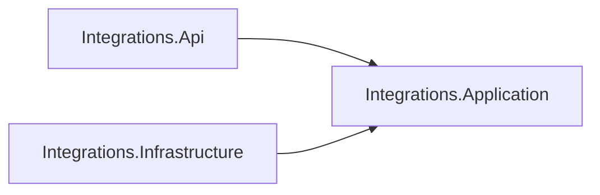

# AiControlCenter.Integrations.Application

Application layer містить `IAiProvider`, typed tool contracts/executor port, credential/repository ports, provider DTO, strict fallback policy, pricing metadata та `ProviderConnectionService`. Сервіс виконує owner-scoped route resolution, повторну provider/connection validation і bounded tool/model cycle; transport adapter не виконує tool напряму.

Application залежить лише від власного Domain. Конкретні HTTP/SDK adapters і Data Protection реалізації залишаються в Infrastructure.

[Integrations](../README.md) · [Infrastructure](../AiControlCenter.Integrations.Infrastructure/README.md) · [Правила залежностей](../../../../docs/architecture/dependency-rules.md)
