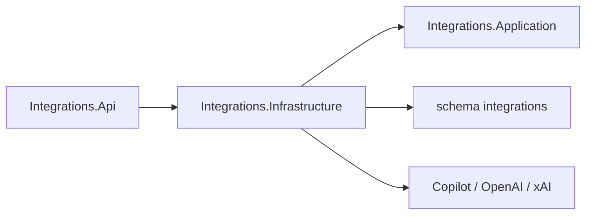

# AiControlCenter.Integrations.Infrastructure

Infrastructure реалізує PostgreSQL repositories/migrations, Data Protection credential protector, GitHub Copilot SDK, OpenAI Responses, xAI і deterministic adapters.

`AddIntegrationsInfrastructure` налаштовує Npgsql, окрему migration history table, persistent key ring, atomic PostgreSQL budget reservations, typed HTTP clients і provider registry. Request caps рахують фактичні outbound catalog/generation/model-turn calls: кожний slot атомарно резервується під owner/connection lock, а pending/ambiguous reservations залишаються зайнятими. Невизначений результат paid POST не звільняє reservation і не дозволяє fallback. Credential та OAuth verifier мають різні context-bound Data Protection purpose chains. Copilot adapter ніколи не використовує logged-in CLI user: він окремо підтверджує GitHub identity, отримує model catalog та best-effort quota, а його tool callbacks лише повертають typed deferred calls application executor-у. Недоступна quota не інвалідує підтверджені identity/catalog.

[Integrations](../README.md) · [Api](../AiControlCenter.Integrations.Api/README.md) · [PostgreSQL isolation tests](../../../../tests/Integration/AiControlCenter.Services.IntegrationTests/README.md)
