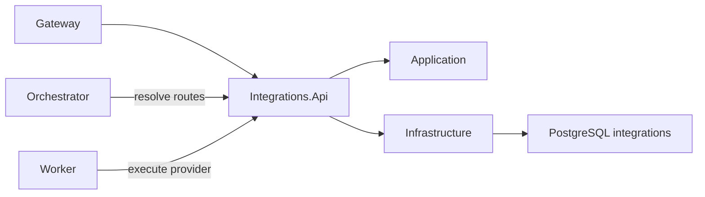

# Integrations

Integrations володіє user-scoped підключеннями AI-провайдерів, OAuth flow GitHub Copilot, write-only OpenAI/xAI API keys, dynamic model catalog, контекстним шифруванням credentials, trusted route resolution, atomic budget reservations, allowlisted tool execution і provider requests через authenticated gRPC. У тестах доступний безкоштовний `DeterministicTestProvider`; live paid requests під час перевірки не виконуються.

- [Api](AiControlCenter.Integrations.Api/README.md)
- [Application](AiControlCenter.Integrations.Application/README.md)
- [Infrastructure](AiControlCenter.Integrations.Infrastructure/README.md)
- [AI providers architecture](../../../docs/architecture/ai-providers.md)

`AiControlCenter.Integrations.Domain` містить `ProviderConnection` та одноразовий OAuth state. Credentials ніколи не повертаються через DTO.

[Межі сервісів](../../../docs/architecture/service-boundaries.md)
